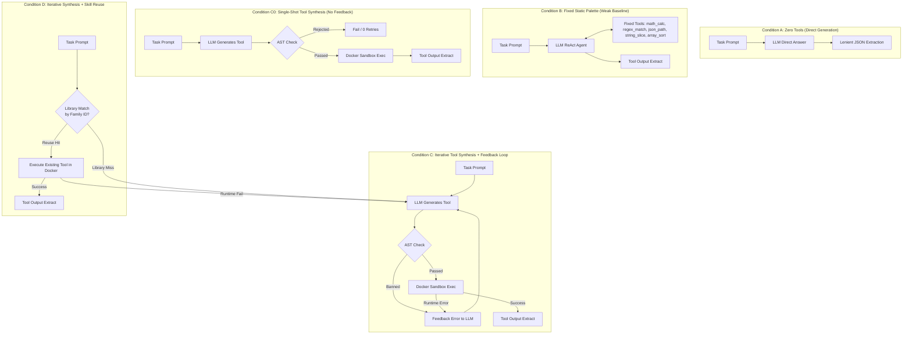

# AetherFlow Evaluation Framework Design: Verified Sandbox + Dynamic Tool Synthesis Loop (v2)

**Author:** AetherFlow Engineering  
**Version:** v0.2-eval-design  
**Status:** SPECIFICATION / EXPERIMENTAL DESIGN (v2 Frozen)  
**Target Subsystem:** `packages/eval/` (Evaluation Benchmark & Comparison Harness)

---

## 1. Executive Summary & Experimental Hypotheses

AetherFlow v0.1 provides a verified sandbox and dynamic tool-synthesis loop for Large Language Model (LLM) agents. The evaluation benchmark assesses the performance, token cost, latency, and reuse characteristics of dynamic tool synthesis against baseline approaches on deterministic tasks.

### Stated Hypotheses (Empirical Test Claims)

1. **Hypothesis 1 (Compute Advantage — C0 vs A):**  
   Single-shot dynamic tool synthesis executed inside a verified sandbox (Condition C0) achieves a higher deterministic pass rate than single-turn direct generation with zero tools (Condition A) on complex computational, multi-step algorithmic, and structured data tasks.

2. **Hypothesis 2 (Error Recovery via Feedback — C vs C0):**  
   Iterative synthesis with static AST feedback and sandbox runtime exception feedback (Condition C) achieves a higher deterministic pass rate than single-shot synthesis without feedback (Condition C0).

3. **Hypothesis 3 (Tool Generality vs Static Palettes — C/C0 vs B):**  
   Dynamic tool synthesis (Conditions C0 and C) achieves higher task coverage than a pre-registered, static tool palette (Condition B) when tasks require specialized algorithms or custom schema transformations not present in the static palette.

4. **Hypothesis 4 (Amortization via Skill Reuse — D vs C):**  
   When evaluated sequentially across families of tasks sharing the same functional specification, persistent tool indexing and reuse (Condition D) reduces cumulative token consumption and execution latency on subsequent family variants relative to Condition C, without a drop in accuracy.

All evaluation reports will present raw counts ($k/n$), sample proportions, and 95% Wilson score confidence intervals:
$$CI_{95\%} = \frac{\hat{p} + \frac{z^2}{2n} \pm z \sqrt{\frac{\hat{p}(1-\hat{p})}{n} + \frac{z^2}{4n^2}}}{1 + \frac{z^2}{n}} \quad (z = 1.96)$$

---

## 2. Experimental Conditions

The benchmark compares five conditions under identical model checkpoints, system prompts, and thinking levels:



### Condition Definitions

| Condition ID | Name | Tool Mechanism | Feedback & Retries | Description |
| :--- | :--- | :--- | :--- | :--- |
| **Condition A** | Single-turn direct | None | 0 retries | LLM directly outputs the final answer. Tests raw model parameter capability. |
| **Condition B** | Fixed tool palette | 5 static tools | Up to 2 turns | Standard ReAct pattern with static utilities (`math_calc`, `regex_match`, `json_path`, `string_slice`, `array_sort`). *Explicitly designated as a weak/restricted baseline.* |
| **Condition C0** | Single-shot dynamic tool | LLM generates JS code | 0 retries | Tool code is synthesized once, linted with AST, executed in Docker. No error feedback or correction. |
| **Condition C** | Iterative dynamic tool | LLM generates JS code | Up to 3 retries | Tool code is synthesized, AST verified, executed in Docker. Errors feed back to LLM for auto-correction. |
| **Condition D** | Dynamic tool + Skill reuse | Indexed tool library + JIT | Up to 3 retries | Library is cleared at start of run. Variant 1 synthesizes and indexes tool. Variants 2 & 3 query library first. |

---

## 3. Benchmark Tasks: 5 Families $\times$ 3 Variants (15 Tasks)

To test tool synthesis and reuse, tasks are structured into **5 distinct functional families**, each containing **3 variants** sharing the exact same algorithmic specification but evaluated on different inputs, edge cases, and domains.

### Structure & Specification Summary

```
Family 1: Text & Delimiter Parser (markdown_table_parser)
  ├── Variant 1a: Employee directory (columns: name, role, salary, active)
  ├── Variant 1b: Server telemetry metrics (columns: host, ip, load_avg, status)
  └── Variant 1c: Financial transactions (columns: tx_id, sender, amount, settled)

Family 2: Algorithmic String Metric (levenshtein_alignment)
  ├── Variant 2a: DNA codon sequences (50 base pairs, substitutions/insertions)
  ├── Variant 2b: Source code diff tokens (identifiers and keywords)
  └── Variant 2c: Natural language sentences with transposition and deletion

Family 3: Graph Traversal with Turn Penalties (dijkstra_turn_penalties)
  ├── Variant 3a: Urban road grid network (15 nodes, directional left/right turn costs)
  ├── Variant 3b: Circuit board trace routing (20 nodes, via layer-change penalties)
  └── Variant 3c: Automated warehouse AGV aisle grid (25 nodes, orientation turn friction)

Family 4: Tabular Pivot & Aggregation (csv_pivot_aggregation)
  ├── Variant 4a: Retail sales dataset (Region x Quarter -> Total Revenue, Avg Margin)
  ├── Variant 4b: Cloud infrastructure logs (Cluster x Tier -> Total Requests, Avg Latency)
  └── Variant 4c: Academic test results (Subject x GradeLevel -> Student Count, Avg Score)

Family 5: Combinatorial 0/1 Knapsack with Dual Constraints (knapsack_dual_constraint)
  ├── Variant 5a: Freight cargo container packing (20 items, max weight + max volume)
  ├── Variant 5b: Space exploration payload allocation (15 items, max mass + max power)
  └── Variant 5c: Cloud VM host placement (25 VM instances, max vCPUs + max RAM)
```

---

## 4. Disambiguation, Feasibility Checking & Self-Tests

Tasks with potentially non-unique outputs (e.g. alternative shortest paths, tie-breaking in knapsacks, multiple edit alignments) use **feasibility and optimality checkers** rather than fragile exact-string matching.

### Ambiguity Resolutions & Checker Specifications

1. **Levenshtein Alignment (`levenshtein_alignment`):**
   - Candidate returns an edit script array: `[{ op: 'keep'|'insert'|'delete'|'substitute', char?: string }]`.
   - Checker applies the operations to source text and verifies:
     1. Applying edit script exactly reproduces target text.
     2. Count of edit operations (`insert + delete + substitute`) strictly equals the mathematical Levenshtein distance computed by standard dynamic programming.

2. **Dijkstra with Turn Penalties (`dijkstra_turn_penalties`):**
   - Candidate returns `{ path: string[], totalCost: number }`.
   - Checker verifies:
     1. Path starts at specified `source` and terminates at `target`.
     2. Every adjacent node pair $(u, v)$ is a directed edge in the graph.
     3. Turn penalties at every intermediate node $(u, v, w)$ are correctly evaluated based on the turn penalty matrix.
     4. Sum of edge weights plus turn penalties equals `totalCost` and strictly matches the known minimum cost.

3. **0/1 Knapsack with Dual Constraints (`knapsack_dual_constraint`):**
   - Candidate returns `{ selectedIndices: number[], totalValue: number }`.
   - Checker verifies:
     1. Feasibility: $\sum_{i \in \text{selected}} \text{weight}_i \le W_{\max}$ and $\sum_{i \in \text{selected}} \text{volume}_i \le V_{\max}$.
     2. Optimality: $\sum_{i \in \text{selected}} \text{value}_i == \text{OptimalValue}$.

4. **Markdown Table Parsing (`markdown_table_parser`):**
   - Strict parsing rules: handles multiline escaped pipes (`\|`), leading/trailing boundary pipes, column header whitespace stripping, and numeric/boolean type coercion where applicable.

5. **CSV Pivot Aggregation (`csv_pivot_aggregation`):**
   - Standard rounding: Floating point averages are verified with a strict rounding tolerance: `Math.abs(cand - ref) < 1e-2`.

### Reference Solutions & Checker Self-Test Protocol

Every benchmark task includes:
1. A deterministic reference implementation (`referenceSolution.ts`).
2. Three explicit synthetic negative test cases:
   - **Case 1 (Invalid Structure):** Malformed object schema, missing required fields.
   - **Case 2 (Feasibility Violation):** Constraint breach (e.g. knapsack capacity exceeded, discontinuous path).
   - **Case 3 (Sub-Optimal Value):** Feasible answer that fails optimality (e.g. non-minimal cost, sub-optimal value).
3. **Automated Self-Test Harness:** Prior to evaluating models, `npm run test:checkers` executes all checkers against reference solutions and negative cases, confirming that every reference solution passes ($15/15$) and every negative case is rejected ($45/45$).

---

## 5. Model Parameters, Reasoning & Cache Key Protocol

### Deprecation of Traditional Sampling Parameters
Recent Gemini model generations (such as Gemini 2.5 Flash, Gemini 3 Flash-Lite, and Gemini 3.8 thinking models) deprecate traditional token-sampling parameters (`temperature`, `top_p`, `top_k`). These parameters are either ignored or trigger warnings, with reasoning models relying on internal optimization policies.

**Evaluation Configuration Policy:**
- Traditional sampling knobs (`temperature`, `top_p`, `top_k`) are **not set** and no claims of fixed temperature are made.
- **Thinking Configuration:** The thinking level is fixed identically across all conditions via standard generation settings (e.g., `thinkingConfig: { thinkingBudget: 1024 }` or `thinking_level: "low"`).
- **Run Repetitions ($N \ge 3$):** Each task variant is evaluated across $N=3$ independent runs to measure variance.
- **Cache Key Formulation:** The run index $r \in \{0, 1, 2\}$ is explicitly incorporated into the cache key:
  $$\text{CacheKey} = \text{SHA256}(\text{model} + \text{systemPrompt} + \text{messages} + \text{thinkingConfig} + \text{runIndex})$$

### Token Accounting & Provenance
Every API turn captures:
- `prompt_tokens`: Input tokens
- `thinking_tokens`: Extracted from `usageMetadata.candidatesTokenDetails[0].thinkingTokenCount` or `usageMetadata.thoughtsTokenCount`
- `output_tokens`: Completion tokens excluding thoughts
- `total_tokens`: Grand total

### Final Answer Provenance & Lenient JSON Extraction
- For Conditions B, C0, C, and D, the final answer evaluated by the checker is derived **strictly from the tool execution output in the sandbox** (`result`), with zero LLM post-processing.
- All conditions utilize identical lenient extraction logic:
  1. Direct `JSON.parse` if valid JSON string.
  2. Regex match on Markdown fenced JSON: ```` ```json\s*([\s\S]*?)\s*``` ````.
  3. First balanced bracket pair `{ ... }` or `[ ... ]` in text.

---

## 6. Condition D: Persistent Skill Library & Semantic Description Reuse

### Zero Oracle Leakage Architecture
1. The tool library (`ToolLibrary`) is initialized **empty** at the beginning of each benchmark repetition.
2. Tasks within each family are evaluated sequentially: **Variant a $\to$ Variant b $\to$ Variant c**.
3. **Strict Oracle and Metadata Isolation:**
   - Retrieval does **NOT** use `task.familyId` or `task.checker`.
   - Matching is computed solely over the normalized agent-visible **task prompt description** using token cosine similarity ($\ge 0.25$ threshold).
   - Candidate validation uses **ONLY agent-visible public examples** (`task.example.input` and `task.example.output`) inside the Docker Sandbox.
   - Hidden checkers are evaluated strictly post-hoc by the external harness.

### Matching & Validation Protocol
- **Variant a (Initial Task in Family):**
  - Library miss $\implies$ synthesizes tool via Condition C loop.
  - If synthesis succeeds, the tool is indexed in `ToolLibrary` keyed by prompt description.
- **Variants b & c (Subsequent Variants):**
  - Prompt description retrieves candidate tool from `ToolLibrary`.
  - Candidate tool is validated in Docker sandbox against `task.example`:
    - If valid: executed on `task.input`. If execution passes $\implies$ **`REUSE_HIT`** recorded (0 LLM synthesis calls).
    - If invalid or execution throws: **`REUSE_MISS`** recorded; falls back to Condition C dynamic synthesis.
- **Reporting Metrics:**
  - **Reuse Hit Rate:** $\frac{\text{Attempted Reuses}}{\text{Eligible Variants (10)}} \times 100\%$
  - **Reuse Precision:** $\frac{\text{Accurate Reuses (Passing Hidden Checker)}}{\text{Attempted Reuses}} \times 100\%$

---

## 7. Metrics & Error Taxonomy

1. **Deterministic Accuracy ($Acc$):**
   $$\text{Pass Rate} = \frac{k}{n_{\text{valid}}} \quad \text{with 95\% Wilson Score Interval}$$
   Where $n_{\text{valid}} = n_{\text{total}} - n_{\text{provider\_errors}}$. Provider outages are isolated and never scored as algorithmic task failures.

2. **AST False-Rejection Rate ($F_{\text{AST}}$):**
   Percentage of tools that are functionally benign and correct but blocked by AST heuristics.

3. **Error Taxonomy Counts:**
   - `SYNTAX_ERROR`: Code fails initial parsing or AST evaluation.
   - `POLICY_BLOCKED`: Code rejected by ASTVerifier banned patterns.
   - `RUNTIME_ERROR`: Uncaught exception or assertion failure inside Docker sandbox.
   - `TIMEOUT`: Execution terminated by sandbox timeout ($8,000\text{ms}$).
   - `WRONG_OUTPUT`: Execution succeeded, but checker rejected output.
   - `PROVIDER_ERROR`: External provider network drop, DNS failure, 503 overload, or 429 quota exhaustion. Excluded from accuracy calculations; marks run as `INCOMPLETE`.
   - `SUCCESS`: Clean execution passing deterministic evaluation.

4. **Token Cost Breakdown:** Average prompt, thinking, output, and total tokens per condition.

5. **Wall-Clock Latency ($L$):** Total latency in milliseconds per condition.

---

## 8. Staged Evaluation Plan, Quotas & Rate Limits

### Free-Tier Model Profiles & Configurable Limits
The evaluation harness supports configurable, per-model rate limits, token quotas, and pacing intervals. By default, the benchmark targets Google's lightweight, high-throughput model: **Gemini 3.5 Flash-Lite** (`gemini-3.5-flash-lite`).

#### Verified Model Specifications (Official Google Documentation)
*Official Documentation: [Google AI for Developers - Models](https://ai.google.dev/gemini-api/docs/models#gemini-3.5-flash-lite)*

| Model Identifier | Release Status | Input / Output Limit | RPM | TPM | RPD | Daily Budget | Min Pacing | Thinking Support | Default Role |
| :--- | :---: | :---: | :---: | :---: | :---: | :---: | :---: | :---: | :--- |
| **`gemini-3.5-flash-lite`** | **Stable (GA)** | 1,048,576 / 65,536 | **15** | **250,000** | **500** | **450** | **~4.5s** | Yes (`minimal` - `high`) | **Main Benchmark Run (Default)** |
| `gemini-3.1-flash-lite` | Stable (GA) | 1,048,576 / 65,536 | 15 | 250,000 | 500 | 450 | ~4.5s | Yes (`minimal` - `high`) | Fallback Lightweight Model |
| `gemini-3.8-flash` | Stable (GA) | 1,048,576 / 65,536 | 5 | 250,000 | 20 | 18 | 13.0s | Yes (`medium`) | Optional Reasoning Spot-Check |
| `gemma-4-26b` / `31b` | Stable (GA) | 131,072 / 8,192 | 30 | 16,000 | 14,400 | 10,000 | 7.5s (TPM-paced) | No (`thinkingConfig` omitted) | Optional Open-Weight Run |

#### Pacing & Thinking Configuration Details
1. **Lightweight Default (`gemini-3.5-flash-lite`):**
   - **Throughput & Limits:** 15 RPM, 250K TPM, and 500 requests/day.
   - **Pacing:** Paced at a minimum interval of **~4.5 seconds** between requests (`Math.max(4500, Math.ceil(60000 / rpm))`), avoiding burst-induced 429s.
   - **Thinking Support:** Natively supports internal reasoning via `thinking_config` (`thinking_level: 'minimal' | 'low' | 'medium' | 'high'`). When deploying on multi-step coding/synthesis tasks, `medium` is configured to prevent premature tool termination.
2. **Gemma 4 TPM-Aware Pacing:**
   - Gemma models operate with a strict **16,000 TPM** limit. To avoid token exhaustion on multi-turn code synthesis (which typically consumes 1,500–2,000 tokens per interaction), requests are paced at **$\ge 7.5$ seconds** ($\le 8$ requests/min).
   - **Thinking Omission:** Gemma models do not support `thinking_level`. The harness inspects `profile.supportsThinking` and strictly omits `thinkingConfig` from API request payloads.
3. **Per-Model Daily Quota Isolation:**
   - The daily budget tracker (`.eval_daily_budget.json`) is keyed by **model identifier** and **Pacific calendar date** (`YYYY-MM-DD`).
   - If `gemini-3.8-flash` exhausts its 20 RPD daily quota, its `blockedUntil` state applies strictly to `gemini-3.8-flash`; `gemini-3.5-flash-lite` continues unaffected on its independent 500 RPD pool.
   - Reset times are calculated relative to Pacific midnight and displayed in local Casablanca time (**08:00 AM GMT+1** during PDT).

### Evaluation Architecture & Staging

With the 500 RPD quota of `gemini-3.5-flash-lite`, the entire multi-condition evaluation can be executed with statistical rigor ($N=3$) in **1 to 2 days**:

```mermaid
flowchart TD
    Main["Main Benchmark Evaluation (gemini-3.5-flash-lite)<br/>Conditions: A, B, C0, C, D | Tasks: 15 | N=3 (225 runs)<br/>Calls: 195-585 (Typ: 312) | Duration: 1-2 Days (Budget: 450/day)"]
    Spot["Optional Reasoning Spot-Check (gemini-3.8-flash)<br/>1 Family (3 Tasks) | Conditions: A, B, C0, C, D | N=1<br/>Calls: 13-39 (Typ: 21) | Budget: 18/day | Separate Quota Block"]
    Gemma["Optional Open-Weight Run (gemma-4-26b)<br/>Conditions: A, B, C0, C, D | Tasks: 15 | N=3<br/>Calls: 195-585 | Pacing: >= 7.5s (TPM-Aware) | Budget: 10,000/day"]

    Main -.->|Cross-Model Comparison (Strictly Segregated)| Spot
    Main -.->|Cross-Architecture Comparison (Strictly Segregated)| Gemma
```

#### Detailed Call Budget Breakdown

| Plan / Model | Conditions | Tasks | Runs ($N$) | Min Calls | Typ Calls | Max Calls | Daily Budget | Est. Duration | Pacing Interval |
| :--- | :---: | :---: | :---: | :---: | :---: | :---: | :---: | :---: | :---: |
| **Main Run (`gemini-3.5-flash-lite`)** | **A, B, C0, C, D** | **15** | **3** | **195** | **312** | **585** | **450 calls/day** | **1–2 days** | **~4.5s** |
| **Spot-Check (`gemini-3.8-flash`)** | A, B, C0, C, D | 3 | 1 | 13 | 21 | 39 | 18 calls/day | 1–2 days | 13.0s |
| **Staged 3.8 (`gemini-3.8-flash`)** | Stage 1 (A, C0, C) | 15 | 1 | 45 | 60 | 90 | 18 calls/day | 3–5 days | 13.0s |
| **Open-Weight (`gemma-4-26b`)** | A, B, C0, C, D | 15 | 3 | 195 | 312 | 585 | 10,000 calls/day | < 1 day | $\ge 7.5$s (TPM-paced) |

> [!IMPORTANT]
> **Strict Model Segregation Policy:**
> Every results file (`eval_results_<model>.json`) and table explicitly logs:
> 1. Exact model code (`model`)
> 2. Thinking setting (`thinkingSetting`)
> 3. Evaluation date in Pacific Time (`evaluationDate`)
> 4. Number of runs per task ($N$)
> 
> Results from different models (e.g. `gemini-3.5-flash-lite`, `gemini-3.8-flash`, `gemma-4-26b`, `local/ollama:*`) are stored in separate files and must **NEVER** be merged, averaged, or pooled into a combined score.

### Scientific Framing & Scope of Claims

To preserve academic integrity and honest reporting:
1. **Lightweight Model Basis:** The benchmark evaluates a lightweight free-tier model (`gemini-3.5-flash-lite`). While capable of fast code generation, smaller models exhibit higher variance and different error modes than 1T+ parameter frontier models.
2. **Suggestive Findings:** The results demonstrate the concrete engineering validity of the verified sandbox, the AST containment layer, and the dynamic skill library on 15 algorithmic benchmark tasks across 5 domains.
3. **Implications for Project Claims:**
   - The evaluation proves that on-the-fly tool synthesis with sandbox execution feedback outperforms static direct code generation for this model family.
   - It proves that runtime skill reuse (Condition D) saves model calls and latency when solving similar variants within a task family.
   - It **does not claim** universal generalizability across all programming tasks, unconstrained real-world software engineering repositories, or disparate model architectures without multi-family empirical evidence.

### Automation Commands

- **Daily Automation (`npm run eval:daily`):**
  1. Inspects `.eval_daily_budget.json` (per-model record keyed to Pacific date) and `eval_checkpoint.json`.
  2. Targets the active model (default: `gemini-3.5-flash-lite`, or `--model=gemini-3.8-flash`).
  3. Enforces 450 daily budget for 3.5 Flash Lite (or 18 for 3.8 Flash) and ~4.5s request pacing.
  4. Automatically runs $N=3$ multi-condition tasks, checkpoints state after each task run, and cleanly exits when the daily budget is met.
  5. Writes isolated results to `eval_results_gemini-3_5-flash-lite.json`.

- **Smoke Test Command (`npm run eval:smoke`):**
  - Dispatches exactly **ONE** live API call to the default model (`gemini-3.5-flash-lite`, or specified via `--model=...`).
  - Verifies HTTP status, model code, thinking configuration, prompt tokens, thinking tokens, output tokens, and response shape.
  - Requires `--allow-live` to prevent accidental execution.

---

## 9. Fail-Closed Security Policy

To prevent arbitrary code execution on host machines during evaluation:
- The evaluation harness **strictly refuses** to execute Conditions C0, C, and D unless:
  1. `Sandbox.isDockerAvailable() === true`
  2. `options.unsafeDevMode !== true`
- If Docker is unavailable, the runner terminates immediately with a fail-closed error.
- `.eval_cache/` and `.env` are excluded in `.gitignore`.
