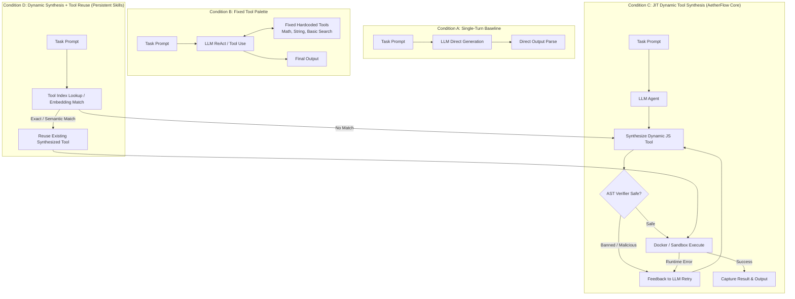
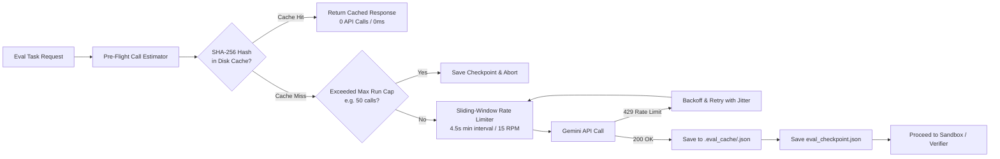

# AetherFlow Evaluation Framework Design: Verified Sandbox + Dynamic Tool Synthesis Loop

**Author:** AetherFlow Engineering  
**Version:** v0.1-eval-design  
**Status:** SPECIFICATION / PLANNING ONLY (Implementation Frozen for Checkpoint A2)  
**Target Subsystem:** `packages/eval/` (Evaluation Benchmark & Comparison Suite)

---

## 1. Executive Summary & Evaluation Hypothesis

AetherFlow v0.1 introduces a verified sandbox and dynamic tool-synthesis loop for Large Language Model (LLM) agents. The fundamental hypothesis behind AetherFlow is:

> **The Tool-Synthesis Hypothesis:**  
> On complex algorithmic, data transformation, and precise computational tasks, an LLM equipped with **Just-In-Time (JIT) Dynamic Tool Synthesis** inside a **multi-layered verified sandbox** (AST verification + secure container execution + automated feedback retry) will achieve:
> 1. Significantly higher accuracy and deterministic correctness than direct single-turn LLM generation (zero tools).
> 2. Significantly greater flexibility and task coverage than fixed, hardcoded tool palettes.
> 3. Substantial token and latency amortization when previously synthesized tools are indexed and reused across related tasks.

This document specifies the exact, reproducible experimental protocol to evaluate this hypothesis empirically.

---

## 2. Experimental Conditions

The benchmark executes every evaluation task across four distinct experimental conditions under identical temperature and model settings:



### Condition Definitions

| Condition ID | Description | Tool Availability | Verification & Execution | Self-Correction Retry |
| :--- | :--- | :--- | :--- | :--- |
| **Condition A** | Single-turn direct generation (No tools) | None (zero external compute) | None | None (1 attempt) |
| **Condition B** | Fixed hardcoded tool palette | Fixed set of 5 pre-registered utilities (`math_calc`, `string_slice`, `regex_match`, `json_query`, `array_sort`) | Pre-registered static tools in Sandbox | Tool error returned to LLM (up to 2 retries) |
| **Condition C** | JIT Dynamic Tool Synthesis | LLM generates specialized TypeScript/JavaScript tool on demand | Static AST linting + Multi-layer Docker Sandbox | AST & runtime stack trace fed back to LLM (up to 3 retries) |
| **Condition D** | Dynamic Synthesis + Skill Reuse | JIT Tool Synthesis + Persistent Library (`ToolForge` + `VectorMemory`) | Pre-execution AST check + Docker Sandbox | First queries library; synthesizes on miss; saves on pass |

---

## 3. Benchmark Tasks (16 Deterministic Tasks)

All tasks are strictly deterministic: inputs and expected outputs are formal, mathematically unambiguous, and verified programmatically without LLM-as-a-judge evaluation.

| # | Task ID | Domain | Input Description | Expected Output / Verifier Criteria | Complexity |
| :- | :--- | :--- | :--- | :--- | :-: |
| 1 | `task_01_rle_compression` | Text / Compression | Arbitrary ASCII string with repeated characters | Exact Run-Length Encoded string format: `char + count` | Low |
| 2 | `task_02_levenshtein_distance` | Text / Dynamic Prog. | Two long strings (200+ chars) with mixed edits | Exact minimum edit distance integer + operation count | Med |
| 3 | `task_03_markdown_table_parser` | Text / Parser | Multiline GitHub Markdown table with escaped pipes and alignment | Array of structured JSON row objects with typed columns | Med |
| 4 | `task_04_semver_canonical_sort` | Text / Specs | List of 25 SemVer 2.0 strings with alpha/beta/rc and build metadata | Array sorted strictly by SemVer 2.0 precedence | Med |
| 5 | `task_05_matrix_eigen_power_iter` | Math / Linear Algebra | 4x4 non-symmetric real matrix + initial vector | Dominant eigenvalue scalar to 4 decimal places | High |
| 6 | `task_06_csv_pivot_aggregation` | Data Analysis / Stats | Raw 500-line sales CSV (region, quarter, product, units, price, margin) | Two-dimensional pivot table JSON: total revenue & avg margin | Med |
| 7 | `task_07_rolling_iqr_anomalies` | Data Analysis / Stats | 1,000-point hourly time series with injected spikes | Exact list of timestamp indices identified as outliers by $1.5 \times \text{IQR}$ | High |
| 8 | `task_08_json_flatten_dot_notation` | Nested Data / Parsing | 5-level deeply nested JSON document with mixed arrays and nulls | Flat dictionary of dot-bracket paths to primitive values | Med |
| 9 | `task_09_cron_next_5_occurrences` | Parsers / Scheduling | Cron string with step values and ranges + reference UTC ISO time | Array of 5 next exact ISO-8601 UTC timestamps | High |
| 10 | `task_10_balanced_parentheses_edit` | Algorithmic / Stack | Corrupted string with mixed `()`, `[]`, `{}` and arbitrary text | Minimal removals to produce canonical balanced expression | Med |
| 11 | `task_11_dijkstra_with_turn_penalties` | Graph / Optimization | Directed graph adjacency list + start/end nodes + turn penalty matrix | Array of node path sequence + total minimal weighted cost | High |
| 12 | `task_12_topological_cycle_detector` | Graph / Dependencies | Dependency map of 30 packages with circular dependencies | Boolean `hasCycle`, and either exact cycle node array or valid build order | High |
| 13 | `task_13_knapsack_dual_constraint` | Combinatorial Optim. | 20 items with value, weight, and volume + weight & volume limits | Maximum feasible total value integer + selected item index set | High |
| 14 | `task_14_lru_cache_simulator` | Systems / Simulation | 50 operations: `get(k)`, `put(k, v)`, `evict()` with capacity $K=5$ | Sequential return values array + final internal MRU-to-LRU key list | Med |
| 15 | `task_15_canonical_huffman_coder` | Information Theory | Character frequency table + target text paragraph | Canonical Huffman codebook dictionary + exact encoded bitstring | High |
| 16 | `task_16_state_machine_dfa_lexer` | Compilers / Automata | Source string containing scientific notation numbers, identifiers, ops | Array of `{ type, value, start, end }` token tuples | High |

---

## 4. Evaluation Metrics

For each task $i$ in condition $c \in \{A, B, C, D\}$:

1. **Deterministic Accuracy ($Acc$):**
   $$\text{Pass}(i, c) = \begin{cases} 1 & \text{if candidate output matches expected output via test checker} \\ 0 & \text{otherwise} \end{cases}$$
   $$\text{Condition Accuracy} = \frac{1}{N} \sum_{i=1}^N \text{Pass}(i, c) \times 100\%$$

2. **Synthesis First-Pass Rate ($S_{first}$):**
   Percentage of tools synthesized in Condition C/D that pass AST verification and execute without runtime error on attempt 1.

3. **Synthesis Eventual Pass Rate ($S_{eventual}$):**
   Percentage of tools synthesized that pass after up to 3 automated retry attempts.

4. **Token Consumption ($T_{prompt}, T_{completion}, T_{total}$):**
   Exact token counts logged per task across all turns and retries.

5. **Wall-Clock Latency ($L$):**
   Total elapsed time in milliseconds from task initiation to final answer submission.

6. **Tool Reuse Rate ($R_{reuse}$ for Condition D):**
   $$\text{Reuse Rate} = \frac{\text{Tasks using cached/indexed tool}}{\text{Total eligible tasks}} \times 100\%$$

---

## 5. Free-Tier Gemini API Cost Controls & Safety Guardrails

Because the project relies on a free-tier Gemini API key (`GEMINI_API_KEY`), strict operational constraints and guardrails are engineered into the evaluation architecture.

### Free-Tier API Quota Limits
- **Requests Per Minute (RPM):** 15
- **Tokens Per Minute (TPM):** 1,000,000
- **Requests Per Day (RPD):** 1,500

### Cost Control Mechanisms



1. **Deterministic Response Cache (`.eval_cache/`):**
   - Every API request is indexed by:
     $$\text{Key} = \text{SHA256}(\text{model} + \text{systemPrompt} + \text{messages} + \text{temperature})$$
   - Cache hits return instantly with zero network traffic and zero API consumption.
   - Any re-run of an evaluation suite with identical parameters consumes **0 API calls**.

2. **Sliding-Window Rate Limiter:**
   - Enforces a minimum delay of 4,200ms between calls (ensuring $\le 14$ RPM, comfortably below the 15 RPM hard ceiling).
   - On encountering HTTP 429, automatically triggers exponential backoff:
     $$T_{\text{backoff}} = \min(60\text{s}, 2^{\text{attempt}} \times 5\text{s}) + \text{random}(0, 2\text{s})$$

3. **Configurable Hard Cap on API Calls per Run:**
   - Default ceiling: `--max-api-calls=50`.
   - If an evaluation run approaches the budget ceiling, the runner halts gracefully, flushes all checkpoints, and alerts the user without discarding progress.

4. **Resumable State Checkpoints (`eval_checkpoint.json`):**
   - After each task completes across conditions, the full state is committed to disk.
   - If interrupted (by user, rate-limit timeout, or process kill), running with `--resume` resumes from task $k+1$ without repeating tasks $1 \dots k$.

5. **Upfront Call Count Estimator:**
   Before any live execution, the CLI prints the exact mathematical upper and lower bounds:
   $$\text{Min Calls} = N_{\text{tasks}} \times (\text{Cond}_A + \text{Cond}_B + \text{Cond}_C + \text{Cond}_D)$$
   $$\text{Max Calls} = N_{\text{tasks}} \times (1 + (1 + R_B) + (1 + R_C) + (1 + R_D))$$
   For 16 tasks with 0 cache hits and max 2 retries:
   - Minimum calls (all pass first try): $16 \times (1 + 1 + 1 + 0) = 48 \text{ calls}$.
   - Maximum calls (all fail and exhaust retries): $16 \times (1 + 3 + 3 + 1) = 128 \text{ calls}$.
   Runs can be sliced into batches of 5 tasks (`--limit=5`) to stay well within daily free-tier quotas (e.g. 20-30 calls per batch).

6. **Local Ollama Fallback (Zero-Cost Verification Option):**
   - The evaluation harness supports `--provider=ollama --model=qwen2.5-coder:7b` for 100% offline, zero-quota, zero-cost regression testing before running against Gemini API.

---

## 6. Implementation Architecture & File Layout

When authorized in Checkpoint B, the evaluation harness will be implemented strictly within `packages/eval/`:

```
packages/eval/
├── package.json                   # Workspace package manifest
├── tsconfig.json                  # TypeScript build configuration
├── src/
│   ├── index.ts                   # CLI entrypoint and benchmark runner
│   ├── types.ts                   # Task schema, Result interfaces, Metric types
│   ├── runner/
│   │   ├── EvalRunner.ts          # Condition executor (A, B, C, D)
│   │   ├── RateLimiter.ts         # Sliding-window rate limiter with backoff
│   │   ├── ResponseCache.ts       # Disk-backed SHA256 response cache
│   │   └── CheckpointManager.ts   # Incremental JSON state persistence
│   ├── tasks/
│   │   ├── task-schema.json       # JSON Schema validation for benchmark tasks
│   │   ├── task-registry.ts       # Task loader and metadata index
│   │   ├── checkers/              # Deterministic evaluation checkers
│   │   │   ├── text-checkers.ts   # Checkers for tasks 01-04
│   │   │   ├── math-checkers.ts   # Checkers for tasks 05-07
│   │   │   ├── parse-checkers.ts  # Checkers for tasks 08-10
│   │   │   └── algo-checkers.ts   # Checkers for tasks 11-16
│   │   └── definitions/           # Task test vectors and prompts (JSON)
│   │       ├── task_01_rle.json
│   │       ├── ...
│   │       └── task_16_dfa.json
│   └── report/
│       ├── MetricsAggregator.ts   # Statistical computation (mean, median, pass rate)
│       └── MarkdownReporter.ts    # Generates raw RESULTS.md with full evidence
```

### Benchmark Task JSON Schema

```json
{
  "$schema": "http://json-schema.org/draft-07/schema#",
  "title": "AetherFlowBenchmarkTask",
  "type": "object",
  "required": ["id", "domain", "title", "prompt", "checkerName", "testInput", "expectedOutput"],
  "properties": {
    "id": { "type": "string" },
    "domain": { "enum": ["text", "math", "data", "parsing", "graph", "combinatorics", "systems"] },
    "title": { "type": "string" },
    "prompt": { "type": "string" },
    "checkerName": { "type": "string" },
    "testInput": { "type": ["string", "object", "array", "number"] },
    "expectedOutput": { "type": ["string", "object", "array", "number"] },
    "timeoutMs": { "type": "number", "default": 10000 },
    "maxTokens": { "type": "number", "default": 2048 }
  }
}
```

---

## 7. Threats to Validity, Risks, & Honest Reporting

1. **Threat: Data Contamination in LLM Training Weights:**
   - *Risk:* The LLM may have memorized textbook Levenshtein or Dijkstra implementations.
   - *Mitigation:* Tasks incorporate domain-specific twists (e.g. Dijkstra with non-standard turn-penalty matrices; Markdown table parsing with irregular multiline pipe escaping) that do not appear in common coding benchmark datasets (HumanEval, MBPP).

2. **Threat: Unfavorable Tool Synthesis Latency:**
   - *Risk:* Dynamic tool synthesis requires AST parsing, container spin-up, and code execution, which will incur higher wall-clock latency than single-turn text generation.
   - *Honest Reporting Rule:* We will explicitly report latency distributions. If Condition C is $3\times$ slower than Condition A, that trade-off must be reported clearly alongside accuracy gains.

3. **Threat: Negative Result (Synthesis Does Not Beat Baseline):**
   - *Policy:* In accordance with Global Rule 6: If dynamic tool synthesis fails to outperform Condition A or B, we will document the exact failure modes (e.g., AST reject false positives, synthesis prompt drift, execution timeout) without hiding or smoothing results.

---

## 8. Checkpoint Boundary & Next Steps

This evaluation design is **strictly frozen** for Checkpoint A2. No evaluation harness code is implemented during this checkpoint. Implementation will occur only upon approval in Checkpoint B.
